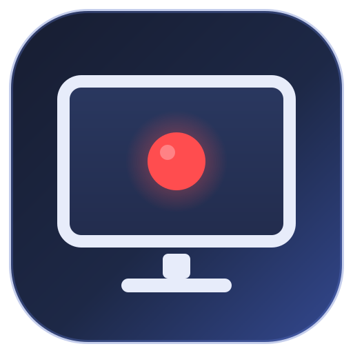
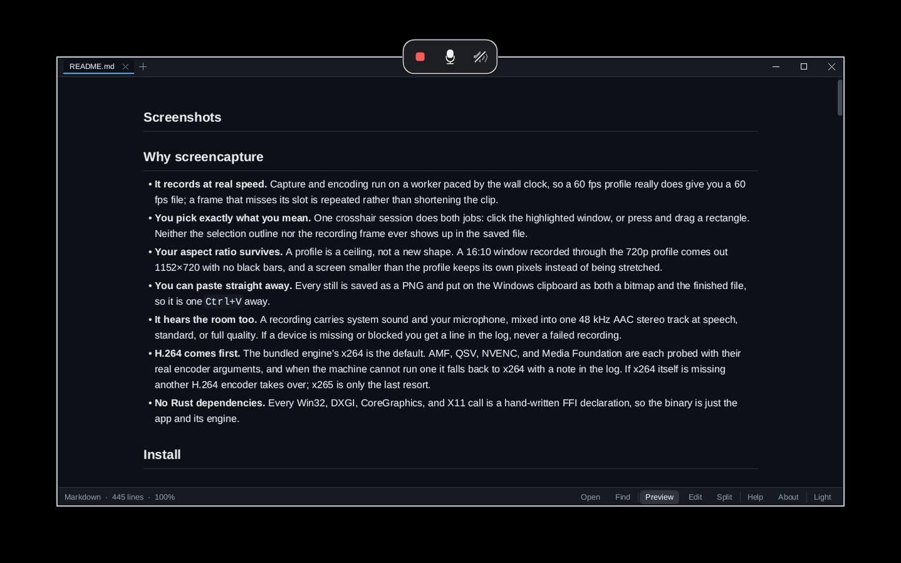
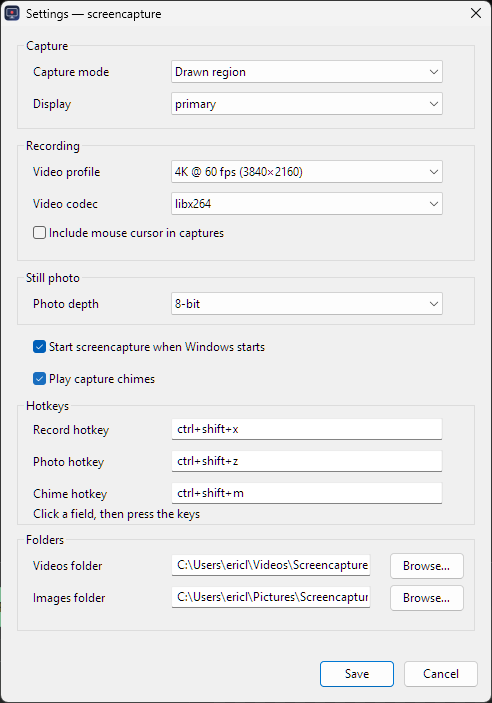
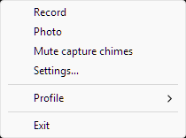

<div align="center">



<h1>screencapture</h1>

<p><strong>Screen recording and still capture that stays out of your way.</strong><br />
A Windows tray app with one crosshair for windows and regions,<br />
and the same capture pipeline headless on macOS and Linux.</p>

<p>
  <a href="https://github.com/Eric-Lautanen/screencapture/actions/workflows/ci.yml"></a>
  <a href="https://github.com/Eric-Lautanen/screencapture/releases/latest"></a>
  
  
  
  
  
  
</p>

</div>

## Screenshots

<table align="center">
  <tr>
    <td align="center" valign="top" colspan="2">
      
      <br />
      <sub><strong>Recording</strong> — a frame that breathes, a Stop button, and the two audio switches, none of which land in the shot.</sub>
    </td>
  </tr>
  <tr>
    <td align="center" valign="top">
      
      <br />
      <sub><strong>Settings</strong> — profile, codec, still quality and PNG
        depth, audio devices and levels, chimes, hotkeys, and folders; the
        title shows the running version.</sub>
    </td>
    <td align="center" valign="top">
      
      <br />
      <sub><strong>Tray menu</strong> — quick actions, profile, and a one-click chime mute.</sub>
    </td>
  </tr>
</table>

## Why screencapture

- **It records at real speed.** Capture and encoding run on a worker paced by
  the wall clock, so a 60 fps profile really does give you a 60 fps file; a
  frame that misses its slot is repeated rather than shortening the clip.
- **You pick exactly what you mean.** One crosshair session does both jobs:
  click the highlighted window, or press and drag a rectangle. Neither the
  selection outline nor the recording frame ever shows up in the saved file.
- **Your aspect ratio survives.** A profile is a ceiling, not a new shape. A
  16:10 window recorded through the 720p profile comes out 1152×720 with no
  black bars, and a screen smaller than the profile keeps its own pixels
  instead of being stretched.
- **You can paste straight away.** Every still is saved at the quality you
  pick — lossless PNG, WebP, or BMP, or a JPEG step — and put on the Windows
  clipboard as a bitmap, so it is one `Ctrl+V` away.
- **It hears the room too.** A recording carries system sound and your
  microphone, mixed into one 48 kHz AAC stereo track at speech, standard, or
  full quality. If a device is missing or blocked you get a line in the log,
  never a failed recording.
- **H.264 comes first.** The bundled engine's x264 is the default. AMF, QSV,
  NVENC, and Media Foundation are each probed with their real encoder
  arguments, and when the machine cannot run one it falls back to x264 with a
  note in the log. If x264 itself is missing another H.264 encoder takes over;
  x265 is only the last resort.
- **No Rust dependencies.** Every Win32, DXGI, CoreGraphics, and X11 call is a
  hand-written FFI declaration, so the binary is just the app and its engine.

## Install

### Windows installer

Download the latest [`screencapture-setup.exe`](https://github.com/Eric-Lautanen/screencapture/releases/latest)
and run it on Windows 10 2004+ or Windows 11. The installer includes the app,
the FFmpeg engine, the license text, and Start Menu shortcuts. The build is
unsigned, so SmartScreen may ask for confirmation.

The install is per-user: no administrator prompt, no Program Files. The app
lands in `%LOCALAPPDATA%\Programs\Screencapture` and uninstalls from
Settings → Apps. Releases up to 0.1.6 installed for all users; if one of
those is still on the machine, remove it first — that uninstall is the only
step left that asks for administrator approval.

### Windows from source

Requires Rust 1.89+ (edition 2024). Windows PowerShell 5.1 ships with supported
Windows versions and is all the fetch script needs. Fetch the pinned engine,
then build:

```bat
scripts\fetch-ffmpeg.cmd
cargo build --release
.\target\release\screencapture.exe --check
.\target\release\screencapture.exe
```

The fetch script uses built-in PowerShell and .NET, so curl is not required.
It verifies the archive size and SHA-256 before extracting `ffmpeg.exe`,
`ffprobe.exe`, and the license into `vendor\ffmpeg\`. `installer\` builds the
NSIS setup program once the release binary and engine are in place.

The tray appears next to the clock; `--settings` opens the Settings window
directly.

### macOS / Linux

The tray, picker, Settings window, global hotkeys, and clipboard handoff are
Windows surfaces. macOS and Linux use the same capture and encoding pipeline
through the CLI and a system FFmpeg:

```sh
# macOS
brew install ffmpeg

# Debian / Ubuntu
sudo apt install ffmpeg

cargo build --release
./target/release/screencapture --check
./target/release/screencapture --record 10 --mode full
```

Pin a specific engine with `[engine] path = /usr/local/bin/ffmpeg` if needed.
Wayland is not supported.

Each platform gates capture behind something a command line user would not
guess. On macOS the compositor answers an empty image until the app that
launched the binary (Terminal, iTerm, or the binary itself) is allowed under
**System Settings → Privacy & Security → Screen Recording**, and the change
needs a restart. On Linux the backend reads the X11 root window, so a Wayland
session shows only its XWayland clients, never the desktop. `--check` prints the
matching hint under a failed `capture:` line.

## Usage

### Global hotkeys

| Action | Default |
|---|---|
| Start / stop recording | `ctrl+shift+x` |
| Take a still | `ctrl+shift+z` |
| Mute / unmute capture chimes | `ctrl+shift+m` |

Combos accept `ctrl`, `alt`, `shift`, and `win` plus a digit, letter, or
`F1`–`F12`. The Settings window validates all three and probes them with a live
`RegisterHotKey` check, then re-registers without a restart.

Vendor overlays commonly claim `ctrl+shift+x`. When Windows refuses a default
combo that is still untouched, startup moves it to the first free alternate
(`ctrl+shift+9`, then `ctrl+alt+9`, and the matching `8`/`7` digits for the
photo and chime hotkeys), saves it, and logs the swap. A combo you chose
yourself is never rewritten; if it is taken, the tray balloon and the log say
so and Settings shows the conflict.

### Tray menu

| Item | Action |
|---|---|
| **Record** | Start or stop with the configured capture mode |
| **Photo** | Take one still with the configured capture mode |
| **Mute capture chimes** | Toggle the confirmation sound and save the choice |
| **Settings…** | Edit the recording, audio, still, hotkey, and folder options live |
| **Profile** | Pick a resolution and frame-rate ceiling |
| **Record display** | Choose a monitor when more than one is attached |
| **Exit** | Stop any active recording and quit |

### Picking a capture target

`[capture] mode` chooses what the Record and Photo actions start:

- **Full screen** records the selected display directly.
- **Drawn region** and **Picked window** share one interactive pass. A plain
  click captures the highlighted window; press and drag to draw a region
  instead. A release within about 8 pixels of the press counts as a click.
  A picked window saves that window's own content, not the pixels it sits
  behind: another application covering it is not in the photo or recording.
- **Escape** or right-click cancels. Escape is read through a low-level keyboard
  watch, so it works even when Windows will not give the overlay focus.

The outline you see while choosing, and the frame around a live recording,
never end up in the picture. During a recording that frame stays quiet: a
light hairline sits on the app's own edge, with a dark line just inside it so
the light one has an edge to read against on pale content, and the whole frame
breathes in its own opacity. It is one continuous line all the way round, with
no gap or overshoot at a corner. The control bar straddles the top edge — stop
on the left, then the microphone and system-sound buttons, which work
mid-take. Escape and the record hotkey stop the take too. A region too narrow
to hold the row keeps the stop button alone.

Both follow the display's real size rather than Windows' scale step alone:
every designed pixel goes through one scale, so the hairline, the bar's button
grid, and its corners grow together. The pill is never narrower than 24 mm,
which is what it measures on a 100 PPI panel, so a 14-inch 1920x1200 laptop
gets a 153x57 pill where a 15.6-inch 1366x768 laptop keeps 96x36, and both
feel the same under the pointer.

### Output

Recordings land in `Videos\Screencapture`; stills land in
`Pictures\Screencapture`. Both are the folders Windows actually gives you: the
shell's own answer, so an account whose `Pictures` folder OneDrive redirected
(a second, empty `Pictures` often stays behind in the profile) still finds its
screenshots where Explorer opens. Videos normally stay local. If both folders
are set to the same path, each medium gets its own `video` or `image`
subfolder instead of mixing files.

Settings creates a destination folder that is missing, and writes a probe
file into it, when the sheet is saved: a path that is really a file, sits on
a read-only drive, or accepts no new files is refused while the field is
still open, rather than after the take it would have lost.

A still is a lossless PNG unless you ask for something else. The **Photo
quality** row in Settings offers six steps: `lossless` (PNG, the default, and
the only one the PNG depth applies to — Settings greys that row, caption and
all, for every other quality), `webp` (lossless WebP — the same
pixels, usually a third of the size), `bmp` (uncompressed 32-bit, for whatever
wants the raw bitmap), `high` (JPEG 95), `standard` (JPEG 85), and `compact`
(JPEG 70). The JPEG steps keep full 4:4:4 colour instead of subsampling it, so
coloured text on a dialog still reads cleanly. On one 1920x1200 desktop take
here, the PNG was 177 KB, the lossless WebP 50 KB, and the BMP 9.2 MB. WebP,
BMP, and JPEG stills are 8-bit and go to the clipboard as a bitmap; the PNG
file flavour is offered for the PNG.

A still, or a stopped recording, answers with a soft three-note chime on
Windows. Mute it from the tray menu, with `ctrl+shift+m`, or in Settings.
Every still is also copied to the Windows clipboard.

A capture that cannot start says so: the log beside the videos names the
reason, and the tray shows a warning balloon with the same text, so a hotkey
press never fails silently. `screencapture --check` prints the engine it
resolved and whether it runs. It also reads the settings back: the two fader
positions in dB and, on Windows, the endpoint each source will actually open
— the Windows default, the chosen device, or one that is away and stands in
for itself with the default — so a silent track is explained before a take.

Recordings carry an AAC stereo audio track. `[recording] system_audio` records
what a playback device plays and is on by default; `mic` records a microphone
and is off by default, so a take never surprises you with your own voice. Both
switches are in Settings and in the file, and both are also on the recording's
control bar: a source the settings left off can be brought in mid-take, from
the moment its button is pressed, because the track exists either way.

Each source also names its device. Settings lists every endpoint the machine
remembers — not just the ones plugged in — so a Bluetooth headset can be chosen
while it is switched off, and the id is what is stored: it survives a rename,
and the headset is recorded from again as soon as it reconnects. A source whose
chosen device is away at the start of a take records the Windows default
instead, says so in the log, and moves to the chosen device the moment it
appears; a device unplugged mid-take is replaced the same way. Chosen a device
that is not in the list any more? It stays in the picker as "(not connected)"
until it comes back.

Windows still owns the device volumes. The two faders in Settings are the
app's own balance, in dB from −60 to +12, applied when the sources are added
together — so a quiet microphone and a loud game can share one track without
touching either device, and at 0 dB a source goes in exactly as its device
delivers it.

Both sources are mixed against the recording clock, so a late packet turns into
a moment of silence instead of drifting out of sync. If the machine has no
playback or capture device, the recording simply goes on without that source —
missing sound never costs you the video.

`audio_quality` decides what the track gets: `speech` (96 kbps) for a
voice-over, `standard` (160 kbps), or the `high` default (320 kbps) that keeps
music intact — at that rate the encoder carries the whole audible band, so what
the speakers played is what the file holds. Settings offers the same three
choices. The track is encoded once, after the mix, so the choice never touches
the picture.

The video profile is a ceiling, not a target: record a 1920×1200 screen with
the 4K profile and you get 1920×1200 at the capture's own 60 fps, not an
upscaled 3840×2160 file. Upscaling added no detail and tripled the pixels a
player had to decode, which is what made 4K takes stutter on playback.

### Command line

```text
screencapture                        Start the tray (Windows)
screencapture --settings             Open Settings and exit (Windows)
screencapture --record [S]           Record S seconds (1-3600, default 3)
screencapture --record S --mode ...  full | region | window
screencapture --display N            Capture display N (1-based, full mode)
screencapture --rect X,Y,W,H         Capture an exact desktop rectangle
screencapture --photo [--mode ...]   Take one still, then exit
screencapture --check                Diagnose settings, audio, displays, and engine
screencapture --init                 Write the default settings file
screencapture --config P             Use a specific settings file
screencapture --version              Print the version
screencapture --help                 Print help
```

`--rect` is the headless area capture for every platform. Recording and still
commands run the same pipeline as the tray, so they double as smoke tests.
Finished recordings are verified with the bundled `ffprobe` on Windows.

The Windows exe is a GUI-subsystem program, so starting the tray never flashes
a console window, and a command run from a terminal prints into that terminal.
`cmd.exe` and PowerShell hand the prompt back instead of waiting for a program
like that, so a script that needs the exit code, or a `--record` that has to
finish first, should use `start /wait` (or `Start-Process -Wait` in PowerShell);
Git Bash waits on its own.

## Configuration

| Platform | Settings file |
|---|---|
| Windows | `%APPDATA%\Screencapture\settings.cfg` |
| macOS | `~/Library/Application Support/Screencapture/settings.cfg` |
| Linux | `$XDG_CONFIG_HOME/Screencapture/settings.cfg` or `~/.config/Screencapture/settings.cfg` |

The file is ordinary `key = value` text, and hand edits load on the next start.
A minimal example:

```ini
[hotkeys]
record = ctrl+shift+x
photo = ctrl+shift+z
chimes = ctrl+shift+m

[capture]
mode = region
# display names the screen a full capture records: primary follows the
# pointer, so the monitor the mouse is on is the one recorded.
display = primary
chimes = true

[photo]
# quality: lossless (PNG), webp (lossless WebP), bmp (uncompressed),
# high (JPEG 95), standard (JPEG 85), or compact (JPEG 70). WebP, BMP,
# and JPEG are 8-bit, so depth applies to PNG only.
quality = lossless
depth = 8

[recording]
profile = hd-1080p60
codec = x264
cursor = false
# Sound: system_audio records a playback device, mic a microphone; both
# mix into one AAC stereo track. Empty device ids follow the Windows
# default; an id is remembered even while that device is unplugged.
mic = false
system_audio = true
mic_device =
mic_device_name =
system_device =
system_device_name =
# Each source's fader in dB: -60 (silence) to +12 (boosted); 0 is as the
# device delivers it.
mic_level = 0
system_level = 0
# audio_quality: speech (96 kbps), standard (160 kbps), high (320 kbps).
audio_quality = high
autostart = true

[media]
videos = "C:\Users\you\Videos\Screencapture"
images = "C:\Users\you\Pictures\Screencapture"
```

Run `screencapture --init` to write the complete commented template (it
refuses to overwrite an existing file). Unknown keys are preserved, and
invalid values fall back to safe defaults with a logged note — the note names
the accepted values, and `screencapture --check` prints the parsed result.

## Platform support

| | Windows 10 2004+ / 11 | macOS | Linux (X11) |
|---|---|---|---|
| Tray icon, menus, hotkeys | ✅ | — | — |
| Settings window | ✅ | — (edit the file) | — (edit the file) |
| Click-to-pick window / drag region | ✅ | — | — |
| Whole-display recording | ✅ Desktop Duplication | ✅ CoreGraphics | ✅ X11 |
| Window recording | ✅ own content (Graphics Capture) | ✅ compositor window list | ✅ X client rect |
| Exact rectangle (`--rect`) | ✅ | ✅ | ✅ |
| Still photos (PNG, WebP, BMP, or JPEG) | ✅ | ✅ | ✅ |
| Recording audio (system + mic, 3 quality levels) | ✅ WASAPI loopback and capture | — | — |
| Clipboard handoff | ✅ | — | — |
| Capture chimes | ✅ | — | — |
| Autostart | ✅ registry | ✅ LaunchAgent | ✅ XDG entry |

Windows is the main surface. macOS and Linux share the capture pipeline and
the CLI, and CI runs their test suites and then starts the release binary on
both runners, but nobody has verified live capture on that hardware yet. Run a
bare `screencapture` there and it prints the command list instead of starting
a tray that cannot exist on that platform.

## How it works

```text
tray / hotkey → target → paced capture worker → FFmpeg → verified MP4 / PNG / JPEG
```

The worker owns the frame source and the encoder pipe. On each pass it grabs a
frame and writes as many copies as the wall clock says are due, so a missed
deadline becomes a repeated frame instead of a short clip. The tray pump only
starts, stops, and watches the worker, which is what keeps the menus and the
recording's control bar responsive mid-recording.

Audio runs alongside the frames: WASAPI loopback and the microphone are mixed
into one 48 kHz stereo PCM stream on the same clock, and the engine reads that
from a named pipe as a second input.

Windows records whole displays through Desktop Duplication, with the mouse
pointer composited in software, and every other target through GDI. A picked
window is the exception: Windows Graphics Capture hands over that window's own
frames, so an application behind another one records itself. macOS draws the
compositor's window list into a BGRA context; Linux reads X11 root images. A
lost duplication session is rebuilt mid-recording while the recording holds
its last frame.

## Releases

Windows release binaries are unsigned, so SmartScreen may ask for
confirmation. Every tag is built from the public source by the
[`Release`](.github/workflows/release.yml) workflow on a GitHub-hosted
Windows runner, and each release ships `SHA256SUMS.txt` so a download can
be checked:

```sh
sha256sum -c SHA256SUMS.txt              # Git Bash, macOS, Linux
Get-FileHash -Algorithm SHA256 .\screencapture-setup.exe   # PowerShell
```

`screencapture --check` verifies the bundled engine against
`vendor/ffmpeg/engine.sha256`.

## Development

The gates are the contract:

```sh
cargo fmt --all --check
cargo clippy --all-targets --locked -- -D warnings
cargo test --all-targets --locked
```

Clippy runs with pedantic lints denied and no `allow` blocks. Cross-check the
ARM and Intel halves with `cargo clippy --target <triple> --all-targets`; the
installed cross targets are kept warning-free.

[GitHub Actions](.github/workflows/ci.yml) runs the native gates on
`windows-latest`, `macos-latest`, and `ubuntu-latest` for every push and pull
request, and starts the release binary there so the platform code loads and
reports instead of panicking. The Windows installer job also records: it runs
`--check`, takes a two-second region take, probes it for H.264 and AAC and a
plausible duration, and writes one still per quality step — PNG, WebP, BMP,
and JPEG — probing each for its codec at the requested size, all with the
bundled engine. `main` is protected: all three
jobs must pass, the branch must be up to date, and admins cannot bypass the
rules.

- [ROADMAP.md](ROADMAP.md) — session history and the deferred backlog
- [AUDIT.md](AUDIT.md) — defect audit and fixes
- [docs/FFMPEG-LICENSE.md](docs/FFMPEG-LICENSE.md) — engine licensing and source

## Engine

The Windows engine is BtbN's `ffmpeg-n9.0.2-28-g669f5ab083-win64-gpl-9.0.zip`
from the pinned [`autobuild-2026-10-18-13-01`](https://github.com/BtbN/FFmpeg-Builds/releases/tag/autobuild-2026-10-18-13-01)
release (`ffmpeg version n9.0.2-28-g669f5ab083-20261018`), shipped with
`ffprobe.exe` and its license text. The archive SHA-256 is
`a38198cc130ed3fa02097d0baebcea9c1b8a9d9d3d1d8161d691d1f03709158b`.
The corresponding source is FFmpeg commit
[`669f5ab083`](https://github.com/FFmpeg/FFmpeg/commit/669f5ab083c7732c10f1ce9e4f1915960dd88457),
built by [BtbN's scripts](https://github.com/BtbN/FFmpeg-Builds).

[`scripts/fetch-ffmpeg.ps1`](scripts/fetch-ffmpeg.ps1) downloads that exact
archive with PowerShell and .NET, checks its byte count and SHA-256, and
installs only the engine, probe, and license. The binaries are not committed;
`--check` records their SHA-256 and reports a mismatch if the engine changes.

On macOS and Linux the app uses the system FFmpeg instead.

## License

The application is [Apache-2.0](LICENSE). The bundled FFmpeg build is a separate
GPLv3+ work: distributing it means shipping its license text and pointing at its
source. See [docs/FFMPEG-LICENSE.md](docs/FFMPEG-LICENSE.md) for the decision and
the upstream link.
